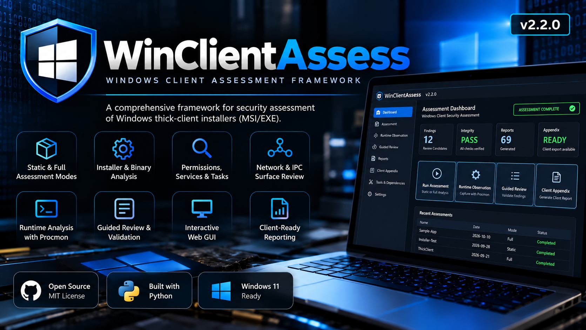

# WCA — Windows Client Assessment

**Version:** v2.2.0 (production release) · **Author:** Matthew B. · **OS:** Windows 11 x64 · **Deployment:** locally hosted browser GUI and CLI

WCA supports authorized assessments of Windows installable MSI/EXE clients and portable EXE/application directories. It combines static analysis, tester-controlled installation snapshots, Windows runtime and IPC inspection, Guided Review, evidence integrity, execution-derived collection provenance and a separately sanitized Client Appendix. The default GUI runs locally on `127.0.0.1:9001` with offline assets. It does **not** automatically install, launch, authenticate to, or exploit targets; testers control every target action and PoC.



*Illustrative product artwork; dashboard figures shown in the banner are examples, not live assessment findings.*

## Get started on a Windows 11 VM

1. Follow [Clean Windows VM Setup](docs/windows-environment-setup.md) for OS preparation, required and optional tools, Python, Sysinternals, and snapshot guidance. For the short version see [Getting Started](docs/getting-started.md).
2. Extract **WCA-v2.2.0-Tester.zip** (tester distribution), or **WCA-v2.2.0.zip** (source and regression tests), to a tester-approved directory. Never run it from inside the archive. Copy `tool_paths.example.json` to `tool_paths.json` **only when custom paths are needed**; do not include that private file in a release or client deliverable.
3. Open Windows PowerShell in the WCA directory. A GUI launch from a standard PowerShell session now requests Administrator approval through Windows UAC *before* starting the local server; launching from an already elevated terminal skips the prompt. Declining UAC leaves the GUI stopped. CLI static/read-only operations, `--help`, and `--version` do not require elevation.

```powershell
.\install_dependencies.ps1
python .\wca.py --version
python .\wca.py --gui
```

When Windows UAC launches an elevated WCA process, use the **new elevated console window** to read the private local URL; keep its complete `#session=` fragment. Keep that elevated console open; background collectors execute without opening another terminal. Use `python .\wca.py` for the fully supported CLI instead. To change the local GUI port use `python .\wca.py --gui --port 9002`.

## Everyday workflow

1. **New Assessment:** choose installable/portable target, Static or Full mode, output folder, and optional collection checkboxes. Static mode does not prompt to install or run the client.
2. **Full mode:** WCA takes a baseline snapshot, pauses for you to install and exercise the client, and continues only after explicit browser confirmation. Network/IPC and optional Procmon collection follow your preselected choices. If Procmon is selected, stop the capture deliberately.
3. **Overview:** monitor background jobs, checkpoints, recent assessments, completion, coverage, integrity and runtime observation history. Page navigation/refresh does not stop the worker while the GUI server remains running.
4. **Guided Runtime Observation:** on a **completed, integrity-verified, same-version Full assessment**, start additional target-scoped capture and press **Stop Guided Runtime Observation** to trigger processing. A previous session does not prevent another. Cross-version evidence modifications remain blocked.
5. **Tester Workspace:** work from a unified Testing Queue that joins linked Guided Review candidates, manual procedures, case-specific report links and optional reviewer notes into one activity. Existing candidate and manual states remain independently integrity-protected. A reviewed candidate alone never proves exploitability or completes a manual test.
6. **Testing Queue:** filter Remaining/Pending Guided Review/Pending Manual Testing/Addressed/All; use `TC-AS-001` for in-scope application and external-tool testing beyond the automatically observed attack surface. Internal notes stay private; explicitly entered client-facing notes are included in the Client Appendix. Native pickers run in a dedicated process to avoid Tkinter request-thread failures.
7. **Client Appendix:** export a reviewed, integrity-verified and sanitized ZIP. Source snapshots and raw full-host Procmon evidence are excluded; validate deliverables before sharing.

## Requirements and optional capabilities

**Core:** Python 3.10+, Windows PowerShell, 7-Zip, dependencies in `requirements.txt`. Recommended integrated utilities include Sysinternals Procmon/AccessChk/Handle/ListDLLs, Detect It Easy, lessmsi and ILSpyCmd (with a suitable .NET SDK). Some utilities need elevation; absent optional utilities degrade specific coverage rather than implying a vulnerability. See [Optional Tools](docs/optional-tools.md), [Windows Setup](docs/windows-environment-setup.md), and [Tool Readiness in the GUI](docs/gui-guide.md). `install_dependencies.ps1` installs Python packages, **not** third-party desktop tools.

## Verification and release acceptance

```powershell
.\install_dependencies.ps1 -TestDependencies
.\scripts\validate_windows.ps1
python .\wca.py --backend-action capabilities --backend-format text
```

The validation script enforces Python exit codes, runs the test suite and release audit, and checks CLI/backend metadata. A full Windows GUI/Procmon acceptance test is separate; see [Windows Acceptance Checklist](docs/windows-validation.md). **v2.2.0 has passed staged Windows field acceptance:** M2-p4 Full Assessment, Guided Runtime and Client Appendix; M2-p5 UAC; and RC1 startup, existing-assessment compatibility, and GUI access. The source and clean-extraction portable suites pass separately. Validate third-party tools and permissions for each engagement; portable regressions do not replace host-specific checks.

## Evidence provenance (introduced in v2.1.0)

Applicable technical evidence `.txt` reports (not summaries, test cases, or tester review) now reference a central `reports/collection_provenance.txt` with the **actual tools and sanitized command structures** recorded during assessment. Where a curated read-only live-recheck command exists, it is explicitly labeled as an independent manual example, not as an executed WCA command. Native Python analysis and skipped collectors are differentiated from external invocations; raw PowerShell scripts and sensitive arguments are never retained. The separate working-state JSON preserves stable execution references through Guided Runtime and review regeneration, and the Client Appendix receives only the allowlisted sanitized `.txt`. See [Collection Provenance](docs/collection-provenance.md).

## Tester Workspace (v2.2.0)

The consolidated GUI guides testers from collection to candidate review, applicable manual tests, guided-only attack-surface testing and final reporting. Each case can display procedure/expected secure behavior and buttons for the referenced reports actually available in the verified assessment. Report previews open in place without losing manual status/notes. Filters cover case ID/title/report, status, category and explicit Guided Review candidate relationships; related candidates do not prove that a manual test is covered or completed. Only actionable issues raise global notifications; routine saves give inline confirmation. The new integrity-tracked `working/manual_test_review.json` records tester statuses separately from `working/tester_review_state.json`; generated `test_cases.txt` remains immutable. Statuses: NOT STARTED, IN PROGRESS, COMPLETED, NOT APPLICABLE, BLOCKED, and conditional ADDRESSED IN GUIDED REVIEW. A manual case remains outstanding while any linked WCR candidate is pending. A test marked COMPLETED is **not** automatically a confirmed vulnerability. Older-version assessments remain read-only in the new GUI. [Tester Workflow Guide](docs/manual-testing-workflow.md).

## Documentation

- [GUI User Guide](docs/gui-guide.md) · [CLI Usage](docs/usage.md) · [Guided Runtime](docs/guided-runtime.md) · [Guided Review](docs/guided-review.md) · [Tester Workspace](docs/manual-testing-workflow.md)
- [Assessment Methodology](METHODOLOGY.md) · [Artifact Catalog](docs/outputs.md) · [Integrity and Recovery](docs/assessment-integrity.md) · [Client Appendix](docs/client-appendix.md)
- [Backend Service](docs/backend-service.md) · [Troubleshooting](docs/troubleshooting.md) · [Release Notes](RELEASE_NOTES.md) · [Changelog](CHANGELOG.md)

**Security and privacy:** Local GUI is bound to loopback with a session token and request checks, but the private URL is an access credential. WCA retains distinct internal evidence under `working/` and tester-facing reports under `reports/`. Review exports for engagement-specific sensitive data. WCA is an assistance tool; findings require human verification.


### Testing Queue workflow

In **Tester Workspace → Testing Queue**, open one activity to see all related WCR candidates as separate collapsible review cards (pending candidates open initially). Each WCR saves independently. The prominently separated **Manual Test Completion** area is for the activity's remaining manual testing; outstanding WCRs continue to count as outstanding activities. **Evidence & Guidance** is for supplemental scope-specific guidance and collection/provenance references, not another checklist. The offline `test_cases.txt` and complete `attack_surface_test_plan.txt` are retained as optional references for traceability, but the GUI does not require repeating them.

### Administrator privilege preflight

Run `python .\wca.py --gui` from **non-Administrator** Windows PowerShell to exercise the UAC prompt. Approve to start WCA in a new elevated console using the same Python interpreter/virtual environment and working directory. Cancel to exit without starting the GUI; repeat from an already elevated terminal to confirm that UAC is not requested again. Full-mode CLI and Guided Runtime also require elevation; static/read-only CLI remains usable without Administrator rights. An elevation attempt is never repeated indefinitely, and a background GUI assessment worker cannot independently invoke UAC. See [Windows Validation](docs/windows-validation.md).


### Production distributions and validation

- **Tester ZIP (`WCA-v2.2.0-Tester.zip`):** runtime engine, GUI, modules, helper PoC scripts, installation requirements and documentation. Excludes regression tests, packaging scripts, generated assessment evidence and machine-specific config.
- **Source ZIP (`WCA-v2.2.0.zip`):** the same runtime plus the complete regression suite, release packaging and validation scripts, and the versioned illustrative cover artwork.
- SHA-256 checksums are supplied for both distributions. Use `python scripts/package_release.py --audit-only` to audit the source ZIP, and the Windows validation script when performing release or environment verification.
- The Windows-accepted RC1 engine was promoted without changing collection or GUI logic. Native system prerequisites and optional tools still require verification on every assessment VM.

[Release validation](docs/release-validation.md) documents the portable regression suites and the Windows field-testing history.
