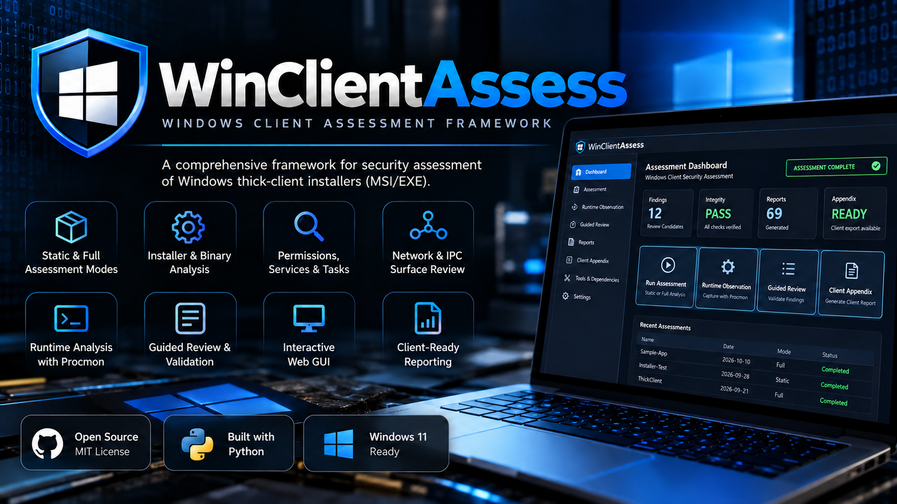

# WCA — Windows Client Assessment

**Version:** v2.2.2 (Windows tester distribution) · **Author:** Matthew B. · **OS:** Windows 11 x64 · **Deployment:** locally hosted browser GUI and CLI

WCA supports authorized assessments of Windows installable MSI/EXE clients and portable EXE/application directories. It combines static analysis, tester-controlled installation snapshots, Windows runtime and IPC inspection, Guided Review, evidence integrity, execution-derived collection provenance and a separately sanitized Client Appendix. The default GUI runs locally on `127.0.0.1:9001` with offline assets. It does **not** automatically install, launch, authenticate to, or exploit targets; testers control every target action and PoC.



*Illustrative promotional dashboard artwork; numbers shown are examples, not actual assessment results.*

## Get started on a Windows 11 VM

1. Follow [Clean Windows VM Setup](docs/windows-environment-setup.md) for OS preparation, required and optional tools, Python, Sysinternals, and snapshot guidance. For the short version see [Getting Started](docs/getting-started.md).
2. Extract **WCA-v2.2.2-Tester.zip** (tester distribution), or **WCA-v2.2.2.zip** (source and regression tests), to a tester-approved directory. Never run it from inside the archive. Use **Tool readiness → Configure tool location** in the GUI to set verified executable paths without editing JSON; manual `tool_paths.json` overrides remain supported; do not include that private file in a release or client deliverable.
3. Open Windows PowerShell in the WCA directory. A GUI launch from a standard PowerShell session now requests Administrator approval through Windows UAC *before* starting the local server; launching from an already elevated terminal skips the prompt. Declining UAC leaves the GUI stopped. CLI static/read-only operations, `--help`, and `--version` do not require elevation.

```powershell
.\install_dependencies.ps1
python .\wca.py --version
python .\wca.py --gui
```

When Windows UAC launches an elevated WCA process, use the **new elevated console window** to read the private local URL; keep its complete `#session=` fragment. Keep that elevated console open; background collectors execute without opening another terminal. Use `python .\wca.py` for the fully supported CLI instead. To change the local GUI port use `python .\wca.py --gui --port 9002`.

## Everyday workflow

1. **New Assessment:** choose installable/portable target, Static or Full mode, output folder, and optional collection checkboxes. Static mode does not prompt to install or run the client.
2. **Full mode:** WCA takes a baseline snapshot, pauses for you to install and exercise the client, and continues only after explicit browser confirmation. Network/IPC and optional Procmon collection follow your preselected choices. If Procmon is selected, stop the capture deliberately.
3. **Overview:** monitor background jobs, checkpoints, recent assessments, completion, coverage, integrity and runtime observation history. Page navigation/refresh does not stop the worker while the GUI server remains running.
4. **Tester Workspace > Runtime Observation:** after an integrity-verified Full Assessment, if no successful Guided Runtime session is recorded, the first Tester Workspace tab recommends a tester-controlled observation **before the Testing Queue**. Start to run the existing workflow, or explicitly skip for this assessment in this browser. A skipped step may be reopened; it never marks collection complete or changes assessment evidence. An older-version assessment remains read-only and cannot run an incompatible capture. Successful prior Guided Runtime sessions hide the introductory step.
5. **Tester Workspace:** work from a unified Testing Queue that joins linked Guided Review candidates, manual procedures, case-specific report links and optional reviewer notes into one activity. Existing candidate and manual states remain independently integrity-protected. A reviewed candidate alone never proves exploitability or completes a manual test.
6. **Testing Queue:** filter Remaining/Pending Guided Review/Pending Manual Testing/Addressed/All; use `TC-AS-001` for in-scope application and external-tool testing beyond the automatically observed attack surface. Internal notes stay private; explicitly entered client-facing notes are included in the Client Appendix. Native pickers run in a dedicated process to avoid Tkinter request-thread failures.
7. **Client Appendix:** export a reviewed, integrity-verified and sanitized ZIP. Source snapshots and raw full-host Procmon evidence are excluded; validate deliverables before sharing.

## Requirements and optional capabilities

**Core:** Python 3.10+, Windows PowerShell, 7-Zip, dependencies in `requirements.txt`. Recommended integrated utilities include Sysinternals Procmon/AccessChk/Handle/ListDLLs, Detect It Easy, lessmsi and ILSpyCmd (with a suitable .NET SDK). Some utilities need elevation; absent optional utilities degrade specific coverage rather than implying a vulnerability. See [Optional Tools](docs/optional-tools.md), [Windows Setup](docs/windows-environment-setup.md), and [Tool Readiness in the GUI](docs/gui-guide.md). `install_dependencies.ps1` installs Python packages, **not** third-party desktop tools.

## Verification and release acceptance

```powershell
.\install_dependencies.ps1 -TestDependencies
python .\wca.py --backend-action capabilities --backend-format text
```

The lean tester ZIP supports the read-only capabilities command above; it does not contain the developer regression suite. In the separately built full-source distribution, `./scripts/validate_windows.ps1` checks Python exit codes, the test suite, release audit and CLI/backend metadata. **Windows field acceptance:** the assessor completed a full v2.2.2 assessment and Client Appendix with no reported issues; all reviewer selections were synthetic testing data and not verified target vulnerabilities. See [Windows Acceptance Checklist](docs/windows-validation.md) for final package and environment-specific smoke checks. Portable regressions do not substitute for native Windows testing.

## First-time tester improvements (v2.2.2)

**Tool readiness:** WCA distinguishes required, recommended, and optional/manual tools. The GUI now lets a tester select a supported tool, browse to its installed executable, save a private `tool_paths.json` override, remove it, and refresh detection. Invalid files are rejected. WCA does not automatically install or launch tools from the configuration UI. The local config is never packaged or exported to the Client Appendix.

**Report procedures:** When viewing a linked report from Testing Queue, **Copy report path** copies the selected assessment’s verified report filename and absolute path, while **Copy PowerShell search** copies an optional read-only search command using that same path. Copy PowerShell search uses the literal nonempty term in the inline report-search field; MSI previews start with `[CUSTOMACTION-` as a convenient quick search. Commands are for read-only external verification and never execute automatically. These actions do not add a second checklist.

The v2.2.2 report-viewer improvements passed focused native Windows acceptance using a verified earlier assessment. Earlier Windows testing validated Static MSI collection, tool-path configuration persistence, report previews/search and specific assessment-creation errors; R1 Windows testing covered a Full MSI assessment, Guided Runtime, review persistence and a sanitized Client Appendix. The final production ZIPs still require a lightweight clean-extraction Windows smoke test; installation-specific external tools must be verified on each workstation.

## Evidence provenance (introduced in v2.1.0)

Applicable technical evidence `.txt` reports (not summaries, test cases, or tester review) now reference a central `reports/collection_provenance.txt` with the **actual tools and sanitized command structures** recorded during assessment. Where a curated read-only live-recheck command exists, it is explicitly labeled as an independent manual example, not as an executed WCA command. Native Python analysis and skipped collectors are differentiated from external invocations; raw PowerShell scripts and sensitive arguments are never retained. The separate working-state JSON preserves stable execution references through Guided Runtime and review regeneration, and the Client Appendix receives only the allowlisted sanitized `.txt`. See [Collection Provenance](docs/collection-provenance.md).

## Tester Workspace (v2.2.2)

For verified Full Assessments without successful Guided Runtime, the first workspace tab is **1 · Runtime Observation**. Review it before testing the queue, or choose the browser-local Skip option when capture is not applicable. The step uses the existing safe, tester-controlled runtime process and is never automatic. The runtime prompt was field-tested in the accepted v2.2.1 baseline.

The consolidated GUI guides testers from collection to candidate review, applicable manual tests, guided-only attack-surface testing and final reporting. Each case can display procedure/expected secure behavior and buttons for the referenced reports actually available in the verified assessment. Report previews open in place without losing manual status/notes. Filters cover case ID/title/report, status, category and explicit Guided Review candidate relationships; related candidates do not prove that a manual test is covered or completed. Only actionable issues raise global notifications; routine saves give inline confirmation. The integrity-tracked `working/manual_test_review.json` records tester statuses separately from `working/tester_review_state.json`; generated `test_cases.txt` remains immutable. Statuses: NOT STARTED, IN PROGRESS, COMPLETED, NOT APPLICABLE, BLOCKED, and conditional ADDRESSED IN GUIDED REVIEW. A manual case remains outstanding while any linked WCR candidate is pending. A test marked COMPLETED is **not** automatically a confirmed vulnerability. Older-version assessments remain read-only in the new GUI. [Tester Workflow Guide](docs/manual-testing-workflow.md).

## Documentation

- [GUI User Guide](docs/gui-guide.md) · [CLI Usage](docs/usage.md) · [Guided Runtime](docs/guided-runtime.md) · [Guided Review](docs/guided-review.md) · [Tester Workspace](docs/manual-testing-workflow.md)
- [Assessment Methodology](METHODOLOGY.md) · [Artifact Catalog](docs/outputs.md) · [Integrity and Recovery](docs/assessment-integrity.md) · [Client Appendix](docs/client-appendix.md)
- [Backend Service](docs/backend-service.md) · [Troubleshooting](docs/troubleshooting.md) · [Release Notes](RELEASE_NOTES.md) · [Changelog](CHANGELOG.md)

**Security and privacy:** Local GUI is bound to loopback with a session token and request checks, but the private URL is an access credential. WCA retains distinct internal evidence under `working/` and tester-facing reports under `reports/`. Review exports for engagement-specific sensitive data. WCA is an assistance tool; findings require human verification.


### Testing Queue workflow

In **Tester Workspace → Testing Queue**, open one activity to see all related WCR candidates as separate collapsible review cards (pending candidates open initially). Each WCR saves independently. The prominently separated **Manual Test Completion** area is for the activity's remaining manual testing; outstanding WCRs continue to count as outstanding activities. **Evidence & Guidance** is for supplemental scope-specific guidance and collection/provenance references, not another checklist. The offline `test_cases.txt` and complete `attack_surface_test_plan.txt` are retained as optional references for traceability, but the GUI does not require repeating them.

### Administrator privilege preflight

Run `python .\wca.py --gui` from **non-Administrator** Windows PowerShell to exercise the UAC prompt. Approve to start WCA in a new elevated console using the same Python interpreter/virtual environment and working directory. Cancel to exit without starting the GUI; repeat from an already elevated terminal to confirm that UAC is not requested again. Full-mode CLI and Guided Runtime also require elevation; static/read-only CLI remains usable without Administrator rights. An elevation attempt is never repeated indefinitely, and a background GUI assessment worker cannot independently invoke UAC. See [Windows Validation](docs/windows-validation.md).


### Production distributions and validation

- **Tester ZIP (`WCA-v2.2.2-Tester.zip`):** runtime engine, GUI, modules, helper PoC scripts, installation requirements and documentation. Excludes regression tests, packaging scripts, generated assessment evidence and machine-specific config.
- **Source ZIP (`WCA-v2.2.2.zip`):** the same runtime plus the complete regression suite, release packaging and validation scripts, and the original source artwork.
- SHA-256 checksums are supplied for both distributions. After extracting the **source** ZIP, use `python scripts/package_release.py --audit-only` and `scripts/validate_windows.ps1` for release or environment verification. The lean tester ZIP intentionally omits validation scripts and tests.
- The v2.2.2 production version promotes the accepted collection and review functionality without new collector or GUI feature changes. Source/tester package smoke checks and local tool readiness must still be verified in each assessment VM.

[Release validation](docs/release-validation.md) documents the portable regression suites and the Windows field-testing history.

## Inline report review and staging guidance

Within **Tester Workspace → Testing Queue**, click a verified file in **Supporting reports** to open the report directly beneath that link. Use the in-report literal search and Next/Previous controls to review matching lines and context. Optional Copy report path and Copy PowerShell search actions are provided. Copied PowerShell searches show matching line numbers and content without a verbose context dump; an empty search disables the action. No external program is launched by the report viewer. A small warning beside the external controls reminds testers that editing and saving the original integrity-protected report may invalidate assessment integrity; make a separate copy before edits.

A collapsed **Why were some manual test cases excluded?** panel explains evidence and mode prerequisites for applicable assessments, without creating additional testing obligations. Older assessment records are not modified.

For repeatable staging, use an approved location such as `C:\Assessments\Targets`, and separately verify effective ACLs. User-profile locations may be legitimate application install paths. A tester's own ability to write a staged artifact is not independently a vulnerability; correlate a lower-trust principal with a higher-privilege consumer and the real installed target.
